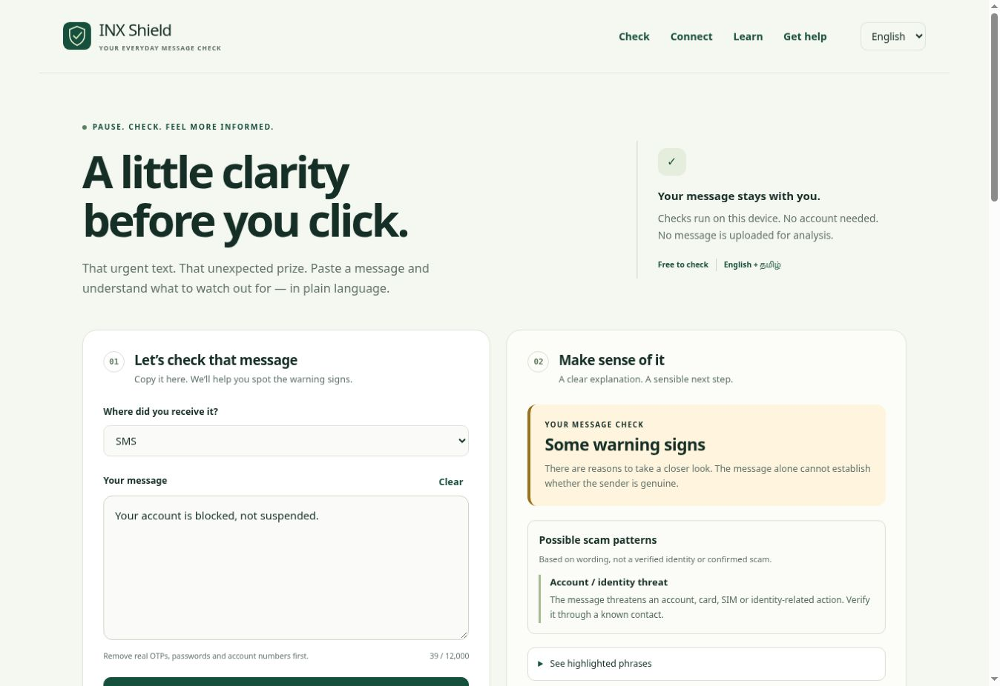

# INX Shield 1.4.1 audit

Audit completed locally on 15 November 2026. This is a bounded code, automated-test and browser audit, not a guarantee that no bugs or undetected scams remain.

Release published on 15 November 2026; production status and live regression evidence rechecked on 17 November 2026.

## Reproduced defects and corrections

| Area | Before | Corrected behavior |
| --- | --- | --- |
| Error translation | An empty/overlength/error message remained in its previous language after switching English/Tamil. | Validation stores an error code and rerenders it in the selected language; new input clears it. |
| Threat negation | “Your account has not been blocked” raised a false warning; “Your account is blocked, not suspended” could hide the actual block warning. | Negation applies to the matched account status. Separate active threats and secret requests remain detectable. |
| Extension link labels | An uppercase `WWW.BANK.EXAMPLE` label was not parsed, so a different destination could go unreported. | WWW matching is case-insensitive; matching hosts still avoid a mismatch warning. |
| Extension capture timing | A slow capture or its failure could overwrite a later pasted message/check. | Editing, checking or starting another capture invalidates the older capture response and error. |
| Cloud account/read timing | Old account rows or an older refresh could replace newer UI state; delayed initial-session reads could restore a signed-out account. | Account generations and request order guard results/errors. Account changes clear previous rows, including sign-out/sign-in to the same account. |
| Cloud failure handling | A thrown sign-out error rejected the action; history failure after successful login was misleading. | Recoverable messages preserve the actual auth state and offer a refresh/retry. |
| Cloud save timing | Language/result rerenders could enable duplicate saves while a request was pending; completion could enable Save after the message had changed. | A per-save token prevents duplicates and respects the current result/account after completion. |

New regression fixtures reproduced the original error translation, threat-negation, uppercase-label, delayed-capture and cloud-state failures before fixes. Follow-up tests also cover successful initialization and overlapping sign-in/auth-event fetches. These controlled cloud fixtures do not imply an observed real-user data leak.

## Verification performed

- **208 Node tests passed** (175 baseline plus 33 added cases). Existing coverage includes detector/Unicode limits, original-text evidence, context safety, feedback masking/review, storage failures, history normalization/deletion/export, service-worker offline and share handoff boundaries, and bundled extension execution.
- Production build passed. The extension ZIP passed CRC checks; every entry matched the corresponding build file. Website, extension and rule engine are `1.4.1`, `1.4.1` and `rules-1.4.1`.
- `npm audit --json` reported **0 known dependency vulnerabilities** at the time checked. This does not establish that the application is free of security vulnerabilities.
- Browser checks: empty-error English/Tamil switching; negative and positive account statuses; secret request, promotion, everyday and insufficient-context results; exact highlighted request; context answers retained across translation without lowering a warning; source-change reset.
- Local browser history: two synthetic summaries, combined/no-match filters, translated expanded guidance, persistence across reload and JSON download while filtered. The downloaded JSON contained both summaries, only allowlisted fields, and no message text, links or context answers. No production user history was deleted.
- Feedback: metadata-only default; synthetic code/email/URL masking; export blocked before review; editing invalidated review; downloaded report contained the reviewed edit; closing/reopening cleared the draft. No GitHub issue was submitted.
- Install-help dialog opened/closed. On the final build the safe share sample completed worker/form navigation, removed the share ID from the URL, filled the composer and returned the expected result after an explicit check.
- Web frames at 320/390/768px had client/scroll widths of 305/305, 375/375 and 753/753 in English and Tamil, including long hostname text and expanded context. A 320px web feedback dialog had client/scroll width 279/279. A 375px extension frame had 360/360, with its feedback dialog 340/340. Screenshots were visually inspected.
- Bundled extension page: unavailable page capture offered manual paste; a Tamil secret request and context guidance rendered correctly. Capture API behavior, uppercase link labels and delayed captures were verified in the bundled-code test fixtures, not by installing the extension into a real Gmail session.
- No application-origin warning/error appeared in the inspected local browser logs; browser-automation extension messages were excluded.
- Input-boundary spot checks finished without an exception: 12,000 plain characters (~24ms), 12,000 compatibility characters expanding under Unicode normalization (~113ms), and 11,760 characters of repeated URLs (~15ms). These are single-run development-machine observations, not device performance guarantees.

## Cloud service recovery and access review

The existing Supabase project was `INACTIVE` and SQL could not connect. Its normal resume/restore operation succeeded, and it reached `ACTIVE_HEALTHY` on 15 November 2026. No paid plan, schema, auth settings, account or access grant was changed.

After recovery, read-only database metadata confirmed:

- Row-level security is enabled on `public.scan_summaries`.
- Anonymous SELECT/INSERT/UPDATE/DELETE are denied.
- Authenticated SELECT/INSERT/DELETE are granted, with owner policies comparing `auth.uid()` to `user_id`.
- Authenticated UPDATE is denied.
- The security advisor returned no lints.

No real user rows or credentials were needed for these checks. Real pilot-account login/save/delete acceptance was not performed. Free projects may pause again after insufficient database activity; see [Supabase project-pausing documentation](https://supabase.com/docs/guides/platform/free-project-pausing).

## Detection limitations that remain

The frozen 60-case synthetic development evaluation is unchanged: **22/24 scam scenarios received a warning, two were missed, and 6/24 benign scenarios received caution**. Twelve ambiguous scenarios are excluded from rates. Dataset SHA-256 remains `486c8ea5c829dd6f7310fb61e8512e66345177020ed5e5a8c671ce70eab2506f`; no cases or labels were changed to improve the result. This is not real-world accuracy or an independent holdout evaluation.

The two misses are indirect Tamil/Tanglish family-impersonation money requests. Genuine fee reminders and short-link newsletters account for the six cautions. Rules cannot establish sender identity, intent or the surrounding conversation. The user's original two messages were not supplied and remain unverified. Physical Android sharing, installed Chrome/Edge extension with real Gmail, real pilot-account acceptance and broad device/browser/screen-reader testing remain rollout checks.

## Publication

- Live app: [INX Shield](https://inx-shield.vercel.app/).
- Published GitHub source commit: [`066e545200c5b1af60caa740477d8642941cb69a`](https://github.com/K-IT-TECH/inx-shield/commit/066e545200c5b1af60caa740477d8642941cb69a). Source tree `ac2c0001209c6627beb6ba827f5edda341eeb94a` matches the locally verified release.
- Vercel production deployment `dpl_qB5Vxd9fzAQQQJzzRaKqdNHhSqrg` was published on 15 November. On 17 November it remained `READY`, associated with that source commit and the public alias, with no alias error.
- Live checks on 15 November confirmed translated validation, the corrected negative/positive account-status behavior, request highlights, Tamil guidance, feedback metadata showing `rules-1.4.1`, and sample sharing. On 17 November, `Your account is blocked, not suspended.` again produced **Some warning signs** with the account/identity-threat explanation. No application-origin warning/error appeared in the inspected live browser logs; browser-automation extension messages were excluded.
- The extension downloaded from the live app on 17 November matched the local release ZIP byte for byte (82,339 bytes; SHA-256 `dc30bb7fe1181e9e820d654f2af9f694f9a46cd1652e4ddc605e4c5f5fcb7de4`). CRC validation passed, and every archive entry matched. This verifies delivery of the package, not installation into a real Gmail session.
- Supabase remained `ACTIVE_HEALTHY` on 17 November. The deployment-scoped error/fatal runtime-log query for the 30-minute window ending 15:18 UTC returned no entries; this is a limited observation, not continuous monitoring or proof that every client succeeds.
- This final publication record and screenshot are documentation-only additions after the app release; they do not require a new application deployment.

### Live regression evidence — 17 November 2026

