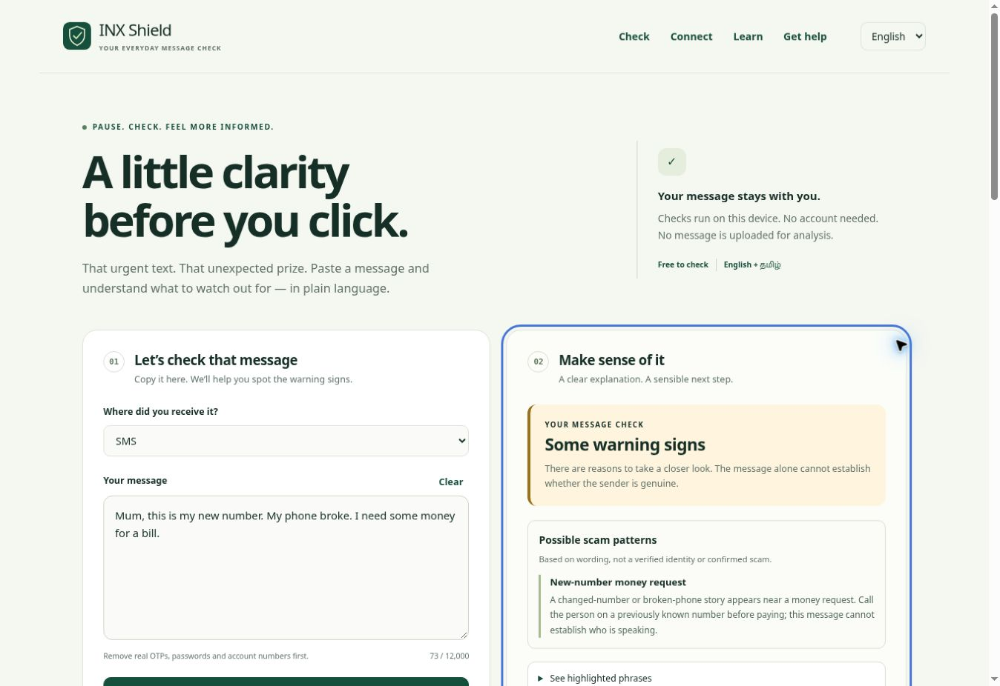

# INX Shield 1.5.0 — detection improvements

Implemented and browser-tested on 17 November 2026; release preparation completed on 18 November. This update targets the detection weaknesses recorded in the 1.4.1 audit. It does not establish real-world accuracy or complete physical-device acceptance.

## Resulting behaviour

- Indirect English, Tamil and Tanglish money requests receive caution when nearby wording describes a changed number, a broken/lost phone or an explicit request for help. Merely announcing a new number or discussing a personal expense does not automatically produce a warning.
- More Tamil money inflections and Tanglish request orders are recognized, including `பணத்தை அனுப்புங்கள்`, `cash transfer pannunga` and `kaasu venum` in the supported context.
- A new bilingual **New-number money request** explanation recommends checking through a previously known number. It describes the wording without claiming to know the sender's identity.
- Explicit school/college office fee reminders retain the payment explanation but do not receive caution solely because they mention a fee. This narrowly requires payment-location wording. An office mention by itself is insufficient; links, captured destinations, changed-contact stories, remote payment cues and high-risk purposes preserve payment warnings.
- Separate money requests retain the strongest weight for their reason code. Repeated neutral fee matches cannot consume the match limit and hide a later request. Secret-code requests and misleading/short-link warnings remain active.
- New-number and fee-reminder examples can be tried in English or Tamil. Extension setup instructions now consistently show 1.5.0 and include the complete Tamil capture/review/check flow.

## Before and after

No existing evaluation text or labels were changed. The additional set was written and run against 1.4.1 before implementation, then frozen. Both sets were available to the implementer and contain related templates; both are synthetic development evaluations, not independent holdouts.

| Dataset and measure | 1.4.1 | 1.5.0 |
| --- | ---: | ---: |
| Original set: warned scam scenarios | 22 / 24 | 24 / 24 |
| Original set: missed scam scenarios | 2 | 0 |
| Original set: cautions on benign scenarios | 6 / 24 | 3 / 24 |
| Expanded set: warned scam scenarios | 13 / 24 | 24 / 24 |
| Expanded set: missed scam scenarios | 11 | 0 |
| Expanded set: cautions on benign scenarios | 12 / 24 | 3 / 24 |

Each set also has 12 ambiguous scenarios excluded from rates. A warning includes both caution and likely-scam results. Remaining benign cautions concern shortened links whose destinations cannot be authenticated from the text. They are intentionally retained rather than trusting newsletter or school wording.

Dataset hashes:

- Original: `486c8ea5c829dd6f7310fb61e8512e66345177020ed5e5a8c671ce70eab2506f`.
- Expanded: `84ce7cc7487547d987c65ac52dcc715f8df86a62237fcb6bdf15be5c5015315e`.

See [methodology and all results](../evaluation/README.md). Passing development cases is not a guarantee against new phrasing, longer conversations, false alarms or identity impersonation.

## Verification

- 263 Node tests pass, including 55 additions covering money requests, negative controls, malicious instructions mixed with office wording, captured destinations, repeated neutral matches, bounded context, bilingual web/extension results and summary privacy.
- Production build and extension archive integrity pass; every ZIP entry matches its build file. App/extension version is 1.5.0; detector version is `rules-1.5.0`.
- Browser checks confirmed English/Tamil new-number caution, its translated explanation and exact money-phrase highlight, a neutral in-person fee reminder, and a fee reminder plus OTP request still returning likely scam.
- A new synthetic summary was saved locally and exported with two existing synthetic summaries. The new record contained only ID, source, verdict, reason codes, time and engine version; no original message, evidence or category text. Default feedback showed `rules-1.5.0` without the message.
- Web frames at 320px and 390px had matching client/scroll widths of 305/305 and 375/375 in English and Tamil. The 375px extension frame also had matching client/scroll widths (360/360 with its Tamil content scrollbar, 375/375 for the shorter English layout). Results and new explanations were visually inspected. These are browser frames, not physical phone tests.
- No application-origin warning/error appeared in the inspected preview logs. Browser-automation extension logs were excluded.
- Single-run development-host input checks: 12,000 plain characters ~16ms, 12,000 compatibility characters expanding under normalization ~117ms, 12,000 repeated money-context characters ~14ms, 11,070 repeated in-person-fee characters ~48ms. These observations do not establish budget-phone performance.

## Compatibility and remaining rollout work

All checks still run locally. No new network dependency, extension permission, cloud schema, auth flow or stored message field was introduced. The existing `payment` reason code keeps new summaries compatible with the database allowlist and older summary presentation; saved verdicts are not recalculated.

Existing extension installations need the new ZIP files and **Reload** on their browser's Extensions page. Physical Android sharing, a real installed Gmail/Edge extension, real pilot-account login/save/delete, broad assistive-technology testing and independently reviewed, consented message evaluation remain unverified. The user's two original messages have still not been supplied.

## Publication

Published on **18 November 2026** to [the live app](https://inx-shield.vercel.app/) from GitHub source commit `3f5c4b351d458a0cc974b17a630287d49e2fbb5f`. Its tree `465431a9c36094ca16b6107f36048f9eb9b10168` matches the locally tested release.

- Production deployment `dpl_2JY7CzC9GrKwrMktjUVvsEvcYdm3` is READY with the correct source commit, the public alias attached and no alias error.
- Live browser checks confirmed English and Tamil indirect money-request cautions, the translated new-number explanation, a neutral in-person fee reminder and an OTP request mixed with fee wording still returning likely scam. Default feedback included `rules-1.5.0` without the test message. No application-origin warning/error appeared in the inspected live logs; browser-automation extension logs were excluded.
- The extension downloaded through the live page is 86,908 bytes, identifies as version 1.5.0, passes ZIP CRC checks and matches the final local archive byte for byte. SHA-256: `b288021490ca943a0f3d0d1100731b9b8ea14c683ce65fbd826d0c6a97874c19`.

The final publication report, checkpoint and screenshot are documentation-only additions after the deployed source commit; they do not change application behaviour. Device and independent-evaluation limits above still apply.
